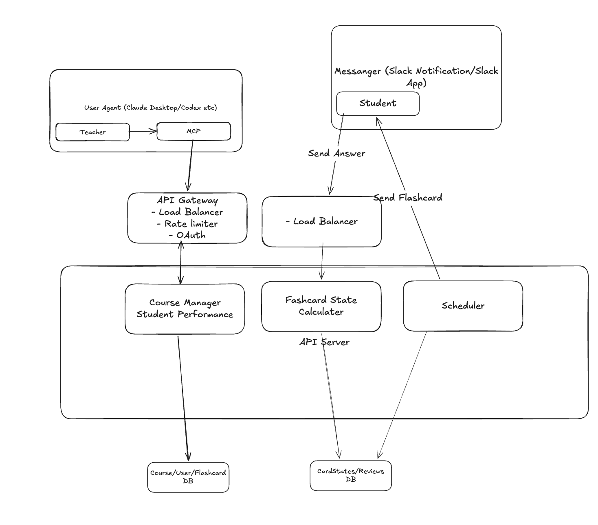

```text
                                                +------------------------------------------+
                                                |   Messanger (Slack Notification/Slack    |
                                                |                   App)                   |
                                                |                                          |
 +----------------------------------------+     |   +-------------+                        |
 | User Agent (Claude Desktop/Codex etc)  |     |   |   Student   |                        |
 |                                        |     |   +-------------+                        |
 |  +---------+           +---------+     |     +-------|------^---------------------------+
 |  | Teacher |---------->|   MCP   |     |             |      |
 |  +---------+           +---------+     |             |      |
 +-----------------------------|----------+ Send Answer |      +----------------+
                               |                        |                       |
                               v                        v                       | Send Flashcard
                 +----------------------+      +-----------------+              |
                 |     API Gateway      |      | - Load Balancer |              |
                 |   - Load Balancer    |      +-----------------+              |
                 |    - Rate limiter    |               |                       |
                 |       - OAuth        |               |                       |
                 +----------------------+               |                       |
                             ^                          |                       |
  +--------------------------|--------------------------|-----------------------|------------+
  |                          v                          v                       |            |
  |               +------------------------+   +------------------+     +--------------+     |
  |               |     Course Manager     |   |  Fashcard State  |     |  Scheduler   |     |
  |               |  Student Performance   |   |    Calculater    |     |              |     |
  |               +------------------------+   +------------------+     +--------------+     |
  |                           |                         |                     |              |
  |                           |                         | API Server          |              |
  |                           |                         |                     |              |
  |                           |                         |                     |              |
  +---------------------------|-------------------------|---------------------|--------------+
                              |                         |         +-----------+
                              v                         v         v
                 +--------------------------+   +----------------------+
                 | Course/User/Flashcard DB |   |CardStates/Reviews DB |
                 +--------------------------+   +----------------------+
```
