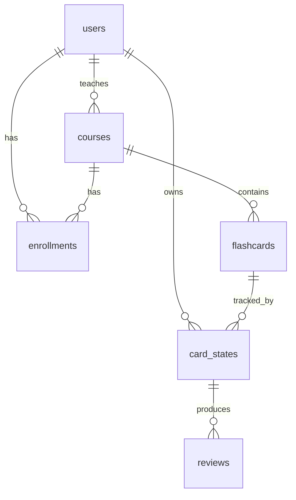

# Data model

Replaces the draft in `data-model-and-api.md` (deleted from the working tree; still in git history). The calculator defines `card_states`; the schema follows it ([fsrs-calculator.md](fsrs-calculator.md)).

Conventions: snake_case, uuid primary keys, `timestamptz`, options and answers 0-based. Engine: PostgreSQL, local Docker first, Railway later ([decision 0023](decisions/0023-local-first.md), which supersedes the Supabase hosting of [0010](decisions/0010-database-postgres-supabase.md)). One deployment per tenant ([decision 0012](decisions/0012-one-deployment-per-tenant.md)), so there is no tenant id. Queries and migrations use Drizzle ([decision 0013](decisions/0013-drizzle-orm-and-kit.md)).

## users

| column | type | notes |
| --- | --- | --- |
| id | uuid PK | |
| full_name | text | |
| email | text unique | matches Slack by `users.lookupByEmail` |
| role | text | `teacher` or `student` |
| slack_id | text null | `U…`; null until matched |
| slack_dm_channel | text null | `D…`, cached from the first `chat.postMessage` |
| tz | text null | IANA, from Slack `users.info`; falls back to `TENANT_TIMEZONE` |
| api_token_hash | text null unique | teachers only; SHA-256 of the token ([decision 0014](decisions/0014-teacher-token-hashed.md)) |

## courses

| column | type | notes |
| --- | --- | --- |
| id | uuid PK | |
| teacher_id | uuid FK users | |
| title, material_url | text | |
| status | text | `draft`, `active`, `finished` |
| assessment_pass_threshold | int | percent, default 90; editable only while the course is `draft` (the assessment is evaluated against it once the course has started) |
| ends_at | timestamptz | NOT NULL; required by the quota ([decision 0006](decisions/0006-new-cards-per-day.md)); on an `active` course it can only be moved later |
| scheduled_start_at, starts_at | timestamptz null | `starts_at` is the real start; `scheduled_start_at` is a plan |

Replaces the old `sent_at` (no meaning).

## enrollments

PK `(course_id, user_id)`.

| column | type | notes |
| --- | --- | --- |
| status | text | `active`, `exempt`, `completed` (see below) |
| completed_at | timestamptz null | set with `completed` |
| completed_progress | numeric null | progress percent frozen when `completed` is set |
| enrolled_at | timestamptz | |
| removed_at | timestamptz null | soft delete ([decision 0017](decisions/0017-enrollment-soft-delete.md)); null for a present student |
| assessment_done_at | timestamptz null | set once, when the last assessment card is answered |
| assessment_score | numeric null | percent 0 to 100 (passed / all × 100), stored for the teacher view; null when the course has no assessment cards |

### Enrollment status ([decision 0011](decisions/0011-enrollment-completed.md))

- `active`: the student gets cards.
- `exempt`: passed the assessment threshold. Progress is 100, no cards, never becomes `completed`.
- `completed`: set when the student has learned all cards (progress 100%) or when the course reaches `ends_at`, whichever comes first. After that no cards are sent. Progress stays as it was: `completed_progress` stores it, so a completed student can be below 100%.

## flashcards

| column | type | notes |
| --- | --- | --- |
| id | uuid PK | |
| course_id | uuid FK | |
| question | text | |
| options | jsonb | array of strings, 2 to 9 entries; "Don't know" is not stored |
| correct_option | int | 0-based index into `options` |
| is_assessment | bool | |
| material_url | text null | |
| position | int | introduction order for new cards |

Cards can be edited or deleted only while the course is `draft`. After start only new cards can be added, and they cannot be assessment cards ([decision 0016](decisions/0016-flashcards-frozen-after-start.md)).

## card_states

PK `(user_id, flashcard_id)`. Every `CardState` field is one column; see the mapping in [fsrs-calculator.md](fsrs-calculator.md#cardstate).

| column | type | source |
| --- | --- | --- |
| due | timestamptz | ts-fsrs `due` |
| stability, difficulty | double precision | ts-fsrs |
| elapsed_days | int | ts-fsrs (deprecated in v6; drop on upgrade) |
| scheduled_days, learning_steps, reps, lapses | int | ts-fsrs |
| state | smallint | ts-fsrs `State` 0 to 3 |
| last_review | timestamptz null | ts-fsrs (`undefined` is null) |
| correct_streak | int default 0 | ours |
| learned_at | timestamptz null | ours |

Scheduler-only columns on the same row (not part of `CardState`):

| column | notes |
| --- | --- |
| introduced_at | first send. Counts toward the daily quota ([decision 0006](decisions/0006-new-cards-per-day.md)) only for non-assessment cards; the quota query filters `flashcards.is_assessment = false` |
| sent_at | when the open question was sent; null when nothing is waiting. The card is open while it is set |
| reminded_at | last reminder time, null if none |
| reminder_count | reminders sent for this delivery, default 0 |
| message_channel, message_ts | the open Slack message |

A row exists from the moment the card is sent, not at enrollment.

## reviews

| column | type | notes |
| --- | --- | --- |
| id | uuid PK | |
| user_id, flashcard_id | FK | |
| chosen_option | int null | null is "Don't know" |
| is_correct | bool | |
| rating | text null | `hard`, `medium`, `easy`; null for wrong or "Don't know" |
| reviewed_at | timestamptz | the `now` passed to the calculator |
| delivery_sent_at | timestamptz | `card_states.sent_at` that this answer closes |

Unique `(user_id, flashcard_id, delivery_sent_at)`: a second click on the same delivery fails the insert and is ignored.

## Derived values

- Present enrollment: `removed_at is null`. Removed students get no cards, are not in class progress, `student_count` or the student lists. One shared predicate in the repository.
- Student progress: `learned_at is not null` count / cards in the course, as a percentage, for `active` enrollments.
- Class progress: average of student progress over present enrollments.
- Waiting since: `sent_at` of the student's open card in the course, null if none; exposed as `waiting_since` in the progress endpoints.
- Open card: `sent_at is not null`. A student with an open card gets no other card; the card never disappears by being ignored, it is re-sent by the reminder rule ([scheduler.md](scheduler.md#unanswered-cards)).
- Ready to send: `learned_at is null and due <= end of the student's local day and sent_at is null`.
- Progress: `completed_progress` for `completed`, 100 for `exempt`, otherwise learned / total.

## Indexes

- `card_states (user_id, due) where learned_at is null`
- `flashcards (course_id, position)`
- `enrollments (user_id)`

## Implementation

Code in `src/db/` ([decision 0022](decisions/0022-task4-schema-choices.md)): `schema.ts` (all tables, row level security on, see Hosting), `mappers.ts` (`CardState` <-> columns, `last_review` undefined <-> NULL), `client.ts`, and the repositories. Migrations are in `drizzle/`.

Local database: `npm run db:up`. `.env.example` points `DATABASE_URL` at the dev database `retain_dev` (created by `npm run db:reset`) and `TEST_DATABASE_URL` at `retain_test` ([decision 0024](decisions/0024-task4a-scenario-choices.md)).

### Hosting

Local Postgres from `docker-compose.yml` for now; managed Postgres on Railway later ([decision 0023](decisions/0023-local-first.md)). Row level security is enabled on every table in the migration; it was added to close the Supabase Data API and no current doc needs it otherwise (open question in decision 0023).
