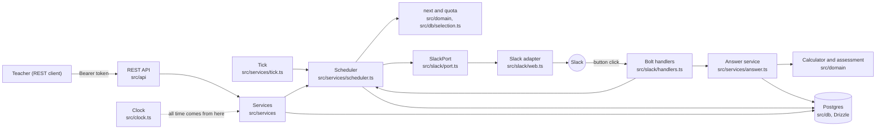
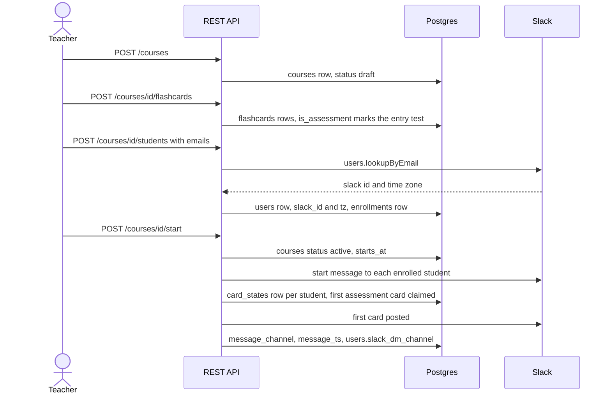
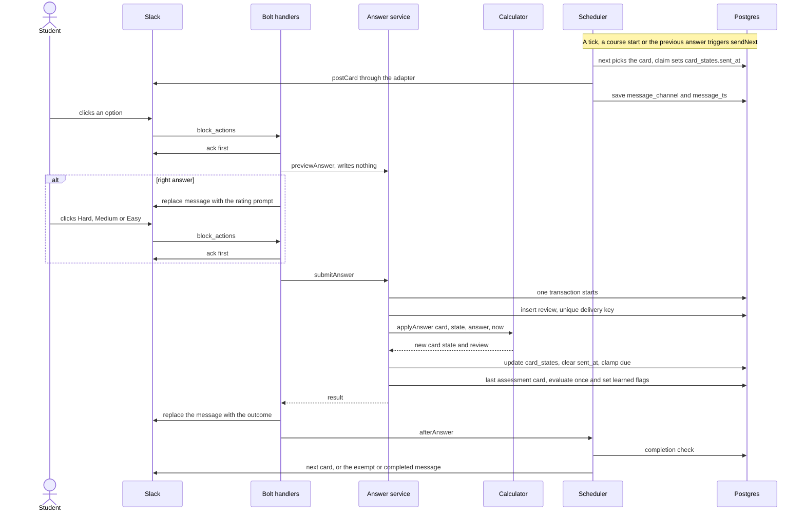
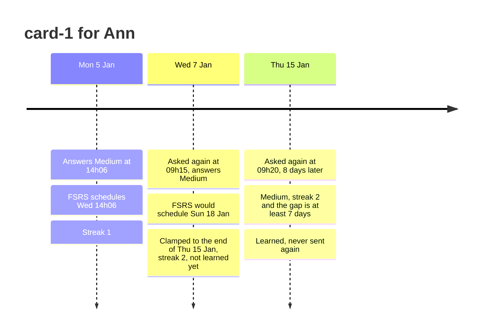

# How it works (one page)

For a live walkthrough: where everything goes and how, as built today (Tasks 1 to 8a). The rules are not repeated here; each section links to the doc that owns them.

## 1. Components

- `src/index.ts` wires it: HTTP server (`startServer`), Slack (Bolt in Socket Mode), the tick. Details: [implementation-plan.md](implementation-plan.md).
- Services and the scheduler get time only from the injected clock, which is why the scenario can advance days. The calculator in `src/domain` has no database, Express or Slack imports.
- The scheduler talks to Slack only through `SlackPort`. Tests and the scenario use `FakeSlack` (`src/slack/fake.ts`).

## 2. Teacher sets up a course

Routes, errors and ownership rules: [rest-api.md](rest-api.md). Tables: [data-model.md](data-model.md).

## 3. Life of one card

- A wrong answer or "Don't know" skips the rating step and goes straight to `submitAnswer`.
- Every click is checked against the clicking Slack user, the stored delivery and the course state; refusals get a text and change nothing.
- Rules and numbers: [scheduler.md](scheduler.md) (what is sent when), [fsrs-calculator.md](fsrs-calculator.md) (what an answer changes), [slack/integration.md](slack/integration.md) (messages and handlers), [decision 0029](decisions/0029-task8-slack-wiring-choices.md).

## 4. One card across days

Real numbers from `npm run scenario` (steps 11, 14, 18), Europe/Zurich, course ends Friday 16 January:

Why the clamp and the 7-day gap: [fsrs-calculator.md](fsrs-calculator.md) and [decision 0015](decisions/0015-learned-needs-retention-gap.md).

To see the whole 12-day run as one picture, run `npm run scenario` and then `npm run scenario:report`, and open `reports/scenario.html`. It shows each card on each day (sent, answered Hard/Medium/Easy, waiting, clamped, learned), cards introduced and learned per day with the 40% outcome, and the exempt student. Details: [scenario.md](scenario.md#report).

## 5. File map

| Where | What lives there |
| --- | --- |
| `src/index.ts` | starts the HTTP server, Slack and the tick |
| `src/config/` | environment variables, validated at startup (zod) |
| `src/clock.ts` | the injectable clock (system and controllable) |
| `src/domain/` | pure rules: calculator, assessment, quota, local-day helpers |
| `src/db/` | Drizzle schema, repositories, mappers, reset script |
| `src/services/` | the use cases: answer, scheduler, tick, courses, enrollment, progress |
| `src/api/` | Express app, token auth, zod schemas, teacher and student routers |
| `src/slack/` | port, real adapter, Bolt handlers, card messages, fake |
| `scripts/` | `scenario.ts` (end-to-end check), `scenario-report.ts` (HTML picture of it), `demo-seed.ts`, `issue-teacher-token.ts`, `dev-api.ts` |
| `drizzle/` | generated SQL migrations |
| `docker-compose.yml` | local Postgres |
| `docs/` | design docs ([implementation-plan.md](implementation-plan.md) is the index) and `decisions/` |

How to run the scenario: [scenario.md](scenario.md). How to try it in a real Slack: [slack/live-run.md](slack/live-run.md).
