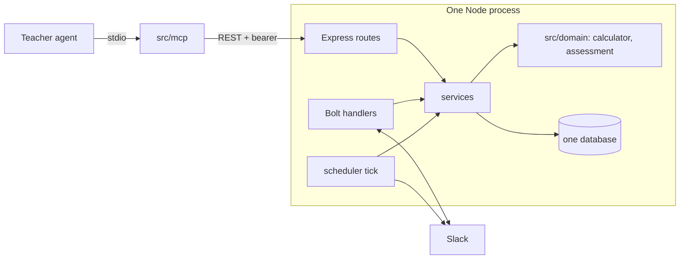

# Implementation plan and index

Design phase output, 2026-10-24. Tasks 1 to 5, 6a, 6b-1, 7 and 8a are built ([0019](decisions/0019-env-config-and-tooling.md), [0020](decisions/0020-slack-spike-choices.md), [0021](decisions/0021-task3-calculator-choices.md), [0022](decisions/0022-task4-schema-choices.md), [0025](decisions/0025-task5-answer-service-choices.md), [0026](decisions/0026-task6-scheduler-choices.md), [0027](decisions/0027-task6b1-tick-choices.md), [0028](decisions/0028-task7-rest-api-choices.md), [0029](decisions/0029-task8-slack-wiring-choices.md)); the rest is not. Read `AGENTS.md` first; this file refines the Roadmap, it does not replace it.

## Design documents

| part | doc |
| --- | --- |
| Data model | [data-model.md](data-model.md) |
| REST API | [rest-api.md](rest-api.md) |
| FSRS and calculator | [fsrs-calculator.md](fsrs-calculator.md) |
| Scheduler | [scheduler.md](scheduler.md) |
| Slack integration | [slack/integration.md](slack/integration.md) (setup in [slack/README.md](slack/README.md)) |
| MCP for teachers | [mcp-teacher-api.md](mcp-teacher-api.md) |
| Worked example | [walkthrough.md](walkthrough.md) |
| Test plan | [test-plan.md](test-plan.md) |
| End-to-end scenario | [scenario.md](scenario.md) |
| Decisions | [decisions/](decisions/) 0002 to 0029 |

`data-model-and-api.md` was the old draft. It is superseded by data-model.md and rest-api.md and is deleted in the working tree (still in git history).

## MVP shape

One Node process. The gateway, rate limiter, OAuth and the second database in the architecture diagram are later.

Layers: routes and Bolt handlers are thin; rules live in services and `src/domain/`. Slack is behind a small interface so services test with a fake.

## Roadmap, refined

| task | content | done when |
| --- | --- | --- |
| 1 Project setup | as in AGENTS.md; install **zod 4**; add `SLACK_MODE`, `TENANT_TIMEZONE` (name from `.env.example`), `SEND_HOUR`, `REMOVED_RETENTION_DAYS`, `STUDENT_ROUTES_ENABLED` (refused with `NODE_ENV=production`) to env | typecheck and test scripts pass; R20 |
| 2 Slack spike | as in AGENTS.md; the buttons and values in [slack/integration.md](slack/integration.md); record in [slack/spike.md](slack/spike.md), [decision 0020](decisions/0020-slack-spike-choices.md) | manual run; click logged and message replaced |
| 3 Calculator | [fsrs-calculator.md](fsrs-calculator.md) plus `evaluateAssessment` | test cases C1 to C23, A1 to A9 |
| 4 Schema and repositories | [data-model.md](data-model.md); [decision 0010](decisions/0010-database-postgres-supabase.md) (hosting superseded by [0023](decisions/0023-local-first.md)); Drizzle and drizzle-kit ([decision 0013](decisions/0013-drizzle-orm-and-kit.md)) | migration runs; repositories round-trip `CardState` including null `last_review`; D1 to D12 ([decision 0022](decisions/0022-task4-schema-choices.md)) |
| 4a End-to-end scenario script (**proposed placement**, [0023](decisions/0023-local-first.md)) | a TypeScript script run with `tsx` that follows [walkthrough.md](walkthrough.md): the teacher creates a course and flashcards, enrolls students, student answers arrive as simulated Slack actions through a fake Slack, and the REST API is driven against local Postgres. Each step has an expected result; a failed step stops with a clear message. Includes a DB reset/init script (migrate + clean) and an injectable clock interface (`now()`), so the script can advance days. Services and the scheduler read time only from that clock. 4a delivers the reset script, the clock and a skeleton; each later task extends the scenario ([scenario.md](scenario.md), [decision 0024](decisions/0024-task4a-scenario-choices.md)) | `npm run scenario` passes the steps available so far; reset script rebuilds an empty database |
| 5 Answer service | transaction: review insert, state update, `due` clamp, assessment evaluation, `learnedAt = now` for passed assessment cards (`evaluateAssessment` returns flags only). Built as `submitAnswer` in `src/services/answer.ts` and `src/domain/localDay.ts` ([decision 0025](decisions/0025-task5-answer-service-choices.md)); completing an enrollment after the last learned card is Task 6 (S16), so until then a student at 100% stays `active` | S2 to S4, S10, S13, S14, S31, S33, S34, S37, S41, S49 to S52, service part only for S3, S10, S34 (the Task 6 and 7 rows add the rest) |
| 6a Scheduler core | `next`, `sendNext`, `sendFirstCards`, `afterAnswer`, completion and `finishCourse`, the Slack port and its fake, `due` clamp fix, scenario section 3 ([decision 0026](decisions/0026-task6-scheduler-choices.md)) | S1, S3 and S4 (rest), S5 to S11, S15 to S17, S21 to S30, S34 (rest), S36, S38, S39 (course part), S42, S46, S53 |
| 6b-1 Daily tick (built) | `runTick` and `startTick` in `src/services/tick.ts` ([decision 0027](decisions/0027-task6b1-tick-choices.md)): `SEND_HOUR` in local time, stale-claim recovery after 10 minutes, `finishEndedCourses` at `ends_at`, `TICK_MINUTES`. Not started from `src/index.ts` until Task 8 | S19, S12; repeated tick sends nothing; S39 (tick part); both Zurich DST days, a student without a Slack id, overlap and `stop()` |
| 6b-2 Reminders, cleanup | reminders (`REMINDER_AFTER_HOURS`, `MAX_REMINDERS`), the 14-day cleanup (stale-claim re-send moved to 6b-1) | S18, S32, S33, S35, S43, S44, S47, S48; reviews and re-enrollment |
| 7 REST API (built) | [rest-api.md](rest-api.md) with token middleware; `src/api/`, `src/services/{courses,flashcards,enrollment,progress,studentReview,auth}.ts`, `scripts/issue-teacher-token.ts`; scenario sections 1, 4, 5 and the removal part of 6 go through REST ([decision 0028](decisions/0028-task7-rest-api-choices.md)) | R1 to R11, R12 to R19, R21 to R29, S20, S40, S45 (R18 and the reminder part of R23 simulated until 6b-2) |
| 8a Slack wiring (built, text cards; first live run 2026-10-26: course start DM, cards, message replacement, right + Easy and the exempt DM verified against real Slack; wrong answer, double click, ack timing, outage/429, tick and stop DM still unverified, see [live-run.md](slack/live-run.md)) | handlers to the answer service, enrollment lookup, course notifications; `src/index.ts` calls `startTick` with the real Slack adapter (`intervalMs` from `TICK_MINUTES`, `sendHour` from `SEND_HOUR`) and implements `SlackPort` with Bolt; move the log timestamp in `src/slack/handlers.ts` (`deps.now ?? new Date()`) to the `Clock` ([decision 0024](decisions/0024-task4a-scenario-choices.md)) `src/index.ts` starts the HTTP server with `startServer` from `src/api/server.ts` and a `bindHost` (the same helper `npm run api` and the tests use), so the loopback check for the student routes cannot be skipped ([decision 0028](decisions/0028-task7-rest-api-choices.md#amendment-student-routes-only-on-a-loopback-host)). | H1 to H10 ([decision 0029](decisions/0029-task8-slack-wiring-choices.md), [live-run.md](slack/live-run.md)) |
| 8b Image card | spike only, not approved: render the question as an image and upload it (`files:write`) | a decision for the user |
| 9 MCP | [mcp-teacher-api.md](mcp-teacher-api.md) | M1 to M4 |

Task 4a is proposed to sit right after Task 4 (numbering of the others is unchanged). After every task the scenario script runs and is extended.

Tasks 5 and 6 can swap; 7 and 9 only need 4 and 5. Tasks 1 to 3 are the first sessions. Each task is a commit with docs updated.

## Risks and ideas

- **State mismatch.** ts-fsrs treats time between sends as elapsed days. If the tick is late, `due` is overdue and FSRS compensates; tests should include a late answer.
- **Rule interplay.** Two learned rules (streak of 2 vs assessment Easy) are easy to confuse. Keep them in two functions with names that say so.
- **Version drift.** Pin `ts-fsrs` and the MCP SDK. `elapsed_days` leaves ts-fsrs in v6.
- **Card quality.** A next-day return after a wrong answer could feel too frequent; switching to `enable_short_term: false` is one constant (decision 0003).
- **Teacher UX.** `start_course` notifies students; the agent should ask first (tool descriptions say so).
- **Idea, later.** Store the FSRS `ReviewLog` in `reviews` to allow rescheduling when parameters change; per-course FSRS retention; a teacher portal is out of scope.
- **Idea, later.** A `MAX_DUE_PER_DAY` cap if a student's backlog grows.
- **Idea, later.** Unreachable students: when Slack returns `channel_not_found` (or `users_not_found` at enrollment), mark the student as unreachable and show it to the teacher next to `slack_matched`. For now only the logging exists ([slack/integration.md](slack/integration.md#identity)).

## Open questions

All earlier open questions are decided: one deployment per tenant ([0012](decisions/0012-one-deployment-per-tenant.md)), Drizzle ([0013](decisions/0013-drizzle-orm-and-kit.md)), hashed teacher token ([0014](decisions/0014-teacher-token-hashed.md)), course end ([0011](decisions/0011-enrollment-completed.md)), new cards join the pool ([0006](decisions/0006-new-cards-per-day.md)).

**Decided for now ([0026](decisions/0026-task6-scheduler-choices.md)): no cutoff, the limit is recorded.** Short courses cannot finish all cards (the scenario's perfect Medium student learns 4 of 10). With the quota spread over the whole course ([0006](decisions/0006-new-cards-per-day.md)) and the 7-day retention gap ([0015](decisions/0015-learned-needs-retention-gap.md)), a perfect Medium student in the walkthrough's 12-day course learns only 4 of 10 cards (the user estimated about 5; Task 6a measured 4). Options: (1) stop new cards `INTRO_CUTOFF_DAYS` (10) before `ends_at`; (2) scale `MIN_RETENTION_DAYS` with course length; (3) require courses of about 4 weeks or more. Details in [scheduler.md](scheduler.md#selecting-the-next-card).

Still to do before real data (hosting later: Railway, [0023](decisions/0023-local-first.md)): script the per-tenant setup before a second customer, (teacher token issuing is scripted: `npm run teacher:token`).

## Facts to recheck at implementation time

Verified by the live spike on 2026-10-25 ([spike.md](slack/spike.md)): `chat.postMessage` to a user id opens the DM with only `chat:write`; the answer and rating flow works; no duplicate `block_actions` in 5 runs (double-click not tested). Still unverified: whether the Bolt web client retries HTTP 429 by default, and the 50-blocks limit. Dependency versions (`@slack/bolt` 5.1.0, `ts-fsrs` 5.4.2, `@modelcontextprotocol/server` 2.4.0) were current on 2026-10-24.
