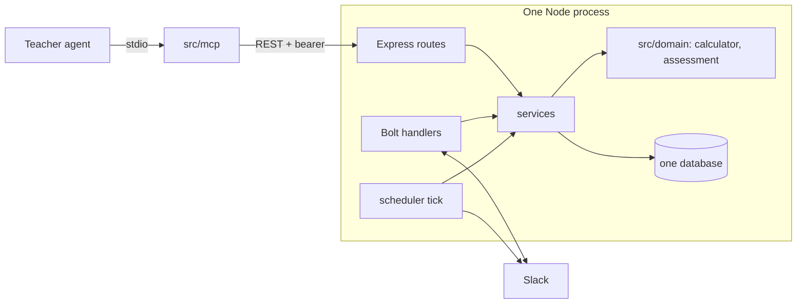

# Implementation plan and index

Design phase output, 2026-10-24. Tasks 1 to 3 are built ([0019](decisions/0019-env-config-and-tooling.md), [0020](decisions/0020-slack-spike-choices.md), [0021](decisions/0021-task3-calculator-choices.md)); the rest is not. Read `AGENTS.md` first; this file refines the Roadmap, it does not replace it.

## Design documents

| part | doc |
| --- | --- |
| Data model | [data-model.md](data-model.md) |
| REST API | [rest-api.md](rest-api.md) |
| FSRS and calculator | [fsrs-calculator.md](fsrs-calculator.md) |
| Scheduler | [scheduler.md](scheduler.md) |
| Slack integration | [slack/integration.md](slack/integration.md) (setup in [slack/README.md](slack/README.md)) |
| MCP for teachers | [mcp-teacher-api.md](mcp-teacher-api.md) |
| Worked example | [walkthrough.md](walkthrough.md) |
| Test plan | [test-plan.md](test-plan.md) |
| Decisions | [decisions/](decisions/) 0002 to 0021 |

`data-model-and-api.md` was the old draft. It is superseded by data-model.md and rest-api.md and is deleted in the working tree (still in git history).

## MVP shape

One Node process. The gateway, rate limiter, OAuth and the second database in the architecture diagram are later.

Layers: routes and Bolt handlers are thin; rules live in services and `src/domain/`. Slack is behind a small interface so services test with a fake.

## Roadmap, refined

| task | content | done when |
| --- | --- | --- |
| 1 Project setup | as in AGENTS.md; install **zod 4**; add `SLACK_MODE`, `TENANT_TIMEZONE` (name from `.env.example`), `SEND_HOUR`, `REMOVED_RETENTION_DAYS`, `STUDENT_ROUTES_ENABLED` (refused with `NODE_ENV=production`) to env | typecheck and test scripts pass |
| 2 Slack spike | as in AGENTS.md; the buttons and values in [slack/integration.md](slack/integration.md); record in [slack/spike.md](slack/spike.md), [decision 0020](decisions/0020-slack-spike-choices.md) | manual run; click logged and message replaced |
| 3 Calculator | [fsrs-calculator.md](fsrs-calculator.md) plus `evaluateAssessment` | test cases C1 to C23, A1 to A9 |
| 4 Schema and repositories | [data-model.md](data-model.md); [decision 0010](decisions/0010-database-postgres-supabase.md); Drizzle and drizzle-kit ([decision 0013](decisions/0013-drizzle-orm-and-kit.md)) | migration runs; repositories round-trip `CardState` including null `last_review` |
| 5 Answer service | transaction: review insert, state update, `due` clamp, assessment evaluation, `learnedAt = now` for passed assessment cards (`evaluateAssessment` returns flags only) | S2 to S4, S10, S13, S14, S37, S49 to S52 |
| 6 Scheduler | selection, tick, idempotent send | S1 to S19 |
| 7 REST API | [rest-api.md](rest-api.md) with token middleware | R1 to R11 |
| 8 Slack wiring | handlers to the answer service, enrollment lookup, course notifications | H1 to H9 |
| 9 MCP | [mcp-teacher-api.md](mcp-teacher-api.md) | M1 to M4 |

Tasks 5 and 6 can swap; 7 and 9 only need 4 and 5. Tasks 1 to 3 are the first sessions. Each task is a commit with docs updated.

## Risks and ideas

- **State mismatch.** ts-fsrs treats time between sends as elapsed days. If the tick is late, `due` is overdue and FSRS compensates; tests should include a late answer.
- **Rule interplay.** Two learned rules (streak of 2 vs assessment Easy) are easy to confuse. Keep them in two functions with names that say so.
- **Version drift.** Pin `ts-fsrs` and the MCP SDK. `elapsed_days` leaves ts-fsrs in v6.
- **Card quality.** A next-day return after a wrong answer could feel too frequent; switching to `enable_short_term: false` is one constant (decision 0003).
- **Teacher UX.** `start_course` notifies students; the agent should ask first (tool descriptions say so).
- **Idea, later.** Store the FSRS `ReviewLog` in `reviews` to allow rescheduling when parameters change; per-course FSRS retention; a teacher portal is out of scope.
- **Idea, later.** A `MAX_DUE_PER_DAY` cap if a student's backlog grows.
- **Idea, later.** Unreachable students: when Slack returns `channel_not_found` (or `users_not_found` at enrollment), mark the student as unreachable and show it to the teacher next to `slack_matched`. For now only the logging exists ([slack/integration.md](slack/integration.md#identity)).

## Open questions

All earlier open questions are decided: one deployment per tenant ([0012](decisions/0012-one-deployment-per-tenant.md)), Drizzle ([0013](decisions/0013-drizzle-orm-and-kit.md)), hashed teacher token ([0014](decisions/0014-teacher-token-hashed.md)), course end ([0011](decisions/0011-enrollment-completed.md)), new cards join the pool ([0006](decisions/0006-new-cards-per-day.md)).

**Open, decide before Task 6 (scheduler):** short courses cannot finish. With the quota spread over the whole course ([0006](decisions/0006-new-cards-per-day.md)) and the 7-day retention gap ([0015](decisions/0015-learned-needs-retention-gap.md)), a perfect Medium student in the walkthrough's 12-day course can learn only about 5 of 10 cards (the user's estimate). Options: (1) stop new cards `INTRO_CUTOFF_DAYS` (10) before `ends_at`; (2) scale `MIN_RETENTION_DAYS` with course length; (3) require courses of about 4 weeks or more. Details in [scheduler.md](scheduler.md#selecting-the-next-card).

Still to do before real data: close the Supabase Data API exposure ([0010](decisions/0010-database-postgres-supabase.md)), script the per-tenant setup before a second customer, and script teacher token issuing.

## Facts to recheck at implementation time

Verified by the live spike on 2026-10-25 ([spike.md](slack/spike.md)): `chat.postMessage` to a user id opens the DM with only `chat:write`; the answer and rating flow works; no duplicate `block_actions` in 5 runs (double-click not tested). Still unverified: whether the Bolt web client retries HTTP 429 by default, and the 50-blocks limit. Dependency versions (`@slack/bolt` 5.1.0, `ts-fsrs` 5.4.2, `@modelcontextprotocol/server` 2.4.0) were current on 2026-10-24.
