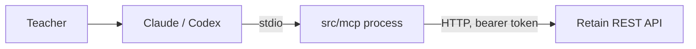

# MCP server for teachers

Teachers use Claude or Codex; the agent calls MCP tools; tools call the REST API ([rest-api.md](rest-api.md)). MCP never touches the database ([decision 0007](decisions/0007-mcp-stdio-thin-client.md)).

## Shape

A separate process, `src/mcp/`, started by the teacher's MCP client over stdio. A thin REST client.



- Config from env: `RETAIN_API_URL`, `RETAIN_API_TOKEN`. Over stdio the MCP spec says to read credentials from the environment, not run OAuth.
- The MCP process uses its own token for the REST call. It never forwards a client token it received.
- stdio is the first step (the only teacher is the author). The target is a remote MCP server over Streamable HTTP with teacher auth (Supabase Auth was planned; superseded by [decision 0023](decisions/0023-local-first.md), remote MCP and OAuth are postponed); that move is a later decision ([decision 0007](decisions/0007-mcp-stdio-thin-client.md#target-and-first-step)).
- Tool definitions live in one transport-independent module (`src/mcp/tools.ts`) with an injected REST client (`src/mcp/client.ts`). Only the entry file (`src/mcp/index.ts`) knows the transport, so the switch to HTTP with `requireBearerAuth` does not change the tools.
- Built in Task 9 ([decision 0031](decisions/0031-task9-mcp-choices.md)). The entry file does **not** import `src/config/env.ts` (it needs Slack tokens and a database URL). It reads only `RETAIN_API_URL` and `RETAIN_API_TOKEN`, refuses to start without them (exit 1, a message on stderr that names the variable and never prints a value), and writes only protocol messages to stdout.

## SDK

`@modelcontextprotocol/server` 2.4.0 (v2 stable, spec 2026-07-28). It needs zod `^4.2`. The older `@modelcontextprotocol/sdk` 1.32.2 is fixes-only, and most online examples still use it (`@modelcontextprotocol/sdk/server/mcp.js`); do not copy those imports. Versions checked 2026-10-24.

Checked in a throwaway install on 2026-10-26 and used as built: `McpServer` and `InMemoryTransport` from `@modelcontextprotocol/server`, `serveStdio` from `@modelcontextprotocol/server/stdio`, `server.registerTool(name, { description, inputSchema, annotations }, handler)` with a zod 4 object as `inputSchema` (import `from 'zod'`, which is v4 in this project; the `zod/v4` path of older examples is not needed). The test client is `@modelcontextprotocol/client` 2.4.0 (a devDependency). Input that fails the schema comes back to the model as an `isError` result ("Input validation error…"), not as a protocol error, and no HTTP call is made. API errors become `{ isError: true, content: [{ type: 'text', text: '<code>: <message>' }] }`, so the model sees the code.

## Tools

16 tools, one per teacher route of [rest-api.md](rest-api.md) (a test compares this table with `src/mcp/tools.ts`). Results are the REST JSON as one text block (`{"ok":true}` for a 204).

| Tool | REST | Notes |
| --- | --- | --- |
| `create_course` | `POST /courses` | creates a draft; `ends_at` required; `scheduled_start_at` is only stored |
| `list_courses` | `GET /courses` | counts included |
| `get_course` | `GET /courses/:courseId` | |
| `update_course` | `PATCH /courses/:courseId` | incl. `assessment_pass_threshold` (draft only); on an `active` course only `ends_at` moving later is accepted for these two fields |
| `start_course` | `POST /courses/:courseId/start` | **messages students**; needs `confirmed: true` after the user has seen all cards with their correct options |
| `stop_course` | `POST /courses/:courseId/stop` | **messages students**; needs `confirmed: true` |
| `delete_course` | `DELETE /courses/:courseId` | destructive, draft only; needs `confirmed: true` |
| `add_flashcards` | `POST /courses/:courseId/flashcards` | batch, with `is_assessment`; after start only non-assessment cards |
| `list_flashcards` | `GET /courses/:courseId/flashcards` | includes `correct_option` |
| `update_flashcard` | `PATCH /flashcards/:flashcardId` | mark or unmark assessment; draft courses only |
| `delete_flashcard` | `DELETE /flashcards/:flashcardId` | draft courses only |
| `enroll_students` | `POST /courses/:courseId/students` | looks up Slack ids |
| `list_students` | `GET /courses/:courseId/students` | |
| `remove_student` | `DELETE /courses/:courseId/students/:studentId` | soft delete ([decision 0017](decisions/0017-enrollment-soft-delete.md)); needs `confirmed: true` |
| `get_class_progress` | `GET /courses/:courseId/progress` | |
| `get_student_progress` | `GET /courses/:courseId/students/:studentId/progress` | |

`remove_student` was missing from the first draft of this table (15 tools for 16 teacher routes); the user added it on 2026-10-26. Not exposed: the two student routes. Students answer in Slack.

### What the descriptions tell the model

Only rules a model would guess wrong, one line each; the REST API stays the authority and its error comes back with the code.

- `add_flashcards`: 1 to 100 cards per call; 2 to 9 options; `correct_option` is 0-based; question at most 500 characters (it is drawn on an image: plain text, Latin with umlauts, Cyrillic including Ukrainian, Greek; no emoji, Arabic, Hebrew or Asian scripts; refusals `question_too_long`, `unsupported_character`, `empty_question`), question plus options at most 2,900 characters; question and options can never be edited; `is_assessment` only while the course is a draft (`assessment_closed`); finished course refuses (`course_finished`).
- `update_course`: at least one field; an active course locks the threshold (`threshold_locked`, even the same value) and only lets `ends_at` move later (`ends_at_shortened`); finished is read-only (`course_finished`). `ends_at` is ISO 8601 with a zone.
- `update_flashcard`, `delete_flashcard`: "DRAFT COURSES ONLY" ([decision 0016](decisions/0016-flashcards-frozen-after-start.md)); an error from a running course comes back as `isError` with `course_not_draft`.
- `enroll_students`: up to 500; `slack_matched: false` means no cards; on a running course the first card goes out at once; a student removed less than 14 days ago is restored.
- `remove_student`: no more cards, the open card shows "expired", re-enrolling within 14 days restores progress.
- Progress tools: a `waiting_since` many days old means the student is blocked on an unanswered card.

### Messages to students: how the model is made to ask

`start_course` and `stop_course` send Slack messages, and `start_course` freezes the cards. Three layers, none of them a security boundary (the teacher's own client also asks for approval of tool calls):

1. The description says in capitals that the tool messages students and cannot be undone, and for `start_course` says that the user's explicit request to start IS the confirmation: the agent calls at once with `confirmed: true`, without listing the cards again or asking for a second approval; only when the agent itself proposes starting does it ask first ([decision 0036](../decisions/0036-start-course-no-second-approval.md)). A test checks the wording.
2. The input schema has a required `confirmed: true` (zod `literal(true)`, JSON Schema `const: true`) on `start_course`, `stop_course`, `delete_course` and `remove_student`. Omitting it, `false`, the string `"true"`, `1`, `null` and an extra key all give an `isError` result and no HTTP call (tests). The flag is never sent to the API.
3. The MCP annotations mark these tools `destructiveHint` and the reads `readOnlyHint`, which lets a client ask for approval.

## Registration

Replace `<ABSOLUTE_PATH_FROM_which_node>` with the output of `which node` on your machine, and `<REPO>` with the absolute path of the repository. All paths must be absolute: Claude Desktop starts the server with a minimal `PATH` and an unknown working directory, so a bare `node` or `tsx` may not be found. There is no build step: the server runs from TypeScript with the `tsx` loader (`node --import <loader> src/mcp/index.ts`). `npm run` and the `tsx` binary are not used because `npm` prints a banner to stdout and the `tsx` binary needs `node` on `PATH`; with an empty environment the form below works (checked).

The token comes from `npm run teacher:token -- <email> "<name>"` (printed once). Put a placeholder in anything you commit.

**Claude Desktop** (format and macOS path from the MCP documentation; quit Claude Desktop completely and start it again after editing). File: `~/Library/Application Support/Claude/claude_desktop_config.json`. Logs of the server's stderr: `~/Library/Logs/Claude/mcp-server-retain.log`.

```json
{
  "mcpServers": {
    "retain": {
      "command": "<ABSOLUTE_PATH_FROM_which_node>",
      "args": [
        "--import", "file://<REPO>/node_modules/tsx/dist/loader.mjs",
        "<REPO>/src/mcp/index.ts"
      ],
      "env": {
        "RETAIN_API_URL": "http://127.0.0.1:3000",
        "RETAIN_API_TOKEN": "<TOKEN_FROM_npm_run_teacher:token>"
      }
    }
  }
}
```

**Claude Code**, local scope (syntax from the Claude Code documentation: options first, `--` before the command; `--transport stdio` sits between `--env` and the server name):

```bash
claude mcp add --env RETAIN_API_URL=http://127.0.0.1:3000 --env RETAIN_API_TOKEN=<TOKEN_FROM_npm_run_teacher:token>   --transport stdio retain -- <ABSOLUTE_PATH_FROM_which_node>   --import file://<REPO>/node_modules/tsx/dist/loader.mjs <REPO>/src/mcp/index.ts
```

Project `.mcp.json` (no token in the file; `RETAIN_API_TOKEN` is read from the shell that starts Claude Code, and an unset variable is passed through as the literal text `${RETAIN_API_TOKEN}`, which the server then sends as a token that the API refuses with `unauthorized`):

```json
{
  "mcpServers": {
    "retain": {
      "type": "stdio",
      "command": "<ABSOLUTE_PATH_FROM_which_node>",
      "args": ["--import", "file://<REPO>/node_modules/tsx/dist/loader.mjs", "<REPO>/src/mcp/index.ts"],
      "env": { "RETAIN_API_URL": "http://127.0.0.1:3000", "RETAIN_API_TOKEN": "${RETAIN_API_TOKEN}" }
    }
  }
}
```

The REST API must be running (`npm run dev`, or `npm run api` for tries without Slack). **`npm run scenario` and `npm run db:reset` wipe `retain_dev`, including the teacher and the token.** While you use MCP against `retain_dev`, do not run them; if you did, run `npm run teacher:token -- <email> "<name>"` again and update the token in the client config. For students who are real people use the separate database of [real-use.md](real-use.md).

## Known limits

- `list_students`, `get_class_progress` and `list_flashcards` return the whole list as one JSON text; a class of hundreds of students gives a large result. No pagination now (the REST API has none).
- Only stdio with one token; the remote server over Streamable HTTP is later ([decision 0007](decisions/0007-mcp-stdio-thin-client.md)).
- `confirmed` makes the model ask, but a determined or confused model can still set it. The user's client approval is the real gate.
- The schemas repeat the REST limits by hand; a change in `src/api/schemas.ts` needs the same change in `src/mcp/tools.ts` (the API stays the authority and answers `invalid_request`). The 2,900-character rule and the 500-character image rule are only in the descriptions and checked by the API.

## Auth to the REST API

One bearer token per teacher ([decision 0014](decisions/0014-teacher-token-hashed.md)). The REST middleware hashes it and finds `users.api_token_hash`. Token issuing for the MVP: `npm run teacher:token -- <email> "<name>"` (`scripts/issue-teacher-token.ts`, built in Task 7) creates the teacher if needed, writes the hash and prints the token once.

## Example session

Teacher: "Create a Compliance course ending Dec 20 with these 6 questions, mark the first 2 as assessment, enroll ann@x.com." The agent calls `create_course`, `add_flashcards`, `enroll_students`, then `list_flashcards` if it wants to check them. When the teacher says "start the course", it calls `start_course` with `confirmed: true` right away.

## Tests

[test-plan.md](test-plan.md#mcp): M1 to M4 with the SDK's in-memory client and server over a fake `fetch` (`src/mcp/tools.test.ts`, `client.test.ts`), and a smoke test that starts the real server as a child process against the real REST app on the test database (`src/mcp/smoke.test.ts`). The scenario's sections 1, 4, 5 and the removal part of 6 call the tools ([scenario.md](scenario.md)).
