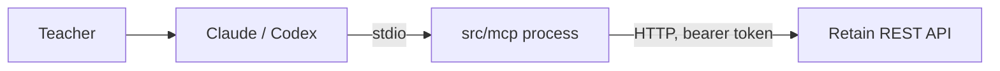

# MCP server for teachers

Teachers use Claude or Codex; the agent calls MCP tools; tools call the REST API ([rest-api.md](rest-api.md)). MCP never touches the database ([decision 0007](decisions/0007-mcp-stdio-thin-client.md)).

## Shape

A separate process, `src/mcp/`, started by the teacher's MCP client over stdio. A thin REST client.



- Config from env: `RETAIN_API_URL`, `RETAIN_API_TOKEN`. Over stdio the MCP spec says to read credentials from the environment, not run OAuth.
- The MCP process uses its own token for the REST call. It never forwards a client token it received.
- stdio is the first step (the only teacher is the author). The target is a remote MCP server over Streamable HTTP with teacher auth (Supabase Auth was planned; superseded by [decision 0023](decisions/0023-local-first.md), remote MCP and OAuth are postponed); that move is a later decision ([decision 0007](decisions/0007-mcp-stdio-thin-client.md#target-and-first-step)).
- Tool definitions live in one transport-independent module (`src/mcp/tools.ts`) with an injected REST client. Only the entry file knows the transport, so the switch to HTTP with `requireBearerAuth` does not change the tools.

## SDK

`@modelcontextprotocol/server` 2.4.0 (v2 stable, spec 2026-07-28). It needs zod `^4.2`. The older `@modelcontextprotocol/sdk` 1.32.2 is fixes-only, and most online examples still use it (`@modelcontextprotocol/sdk/server/mcp.js`); do not copy those imports. Versions checked 2026-10-24.

```ts
import { McpServer } from '@modelcontextprotocol/server';
import * as z from 'zod/v4';

const server = new McpServer({ name: 'retain', version: '0.1.0' });
server.registerTool('create_course',
  { description: 'Create a draft course', inputSchema: z.object({ title: z.string(), material_url: z.string().url(), ends_at: z.string() }) },
  async (args) => ({ content: [{ type: 'text', text: JSON.stringify(await api.post('/courses', args)) }] }));
```

Serve with `serveStdio(() => server)` from `@modelcontextprotocol/server/stdio` (check the v2 docs at implementation time). API errors become `{ isError: true, content: [...] }`, so the model sees them.

## Tools

| Tool | REST | Notes |
| --- | --- | --- |
| `create_course` | `POST /courses` | creates a draft |
| `list_courses` | `GET /courses` | counts included |
| `get_course` | `GET /courses/:courseId` | |
| `update_course` | `PATCH /courses/:courseId` | incl. `assessment_pass_threshold` (draft only); on an `active` course only `ends_at` moving later is accepted for these two fields |
| `start_course` | `POST /courses/:courseId/start` | notifies students; say so in the description |
| `stop_course` | `POST /courses/:courseId/stop` | notifies students |
| `delete_course` | `DELETE /courses/:courseId` | destructive, draft only |
| `add_flashcards` | `POST /courses/:courseId/flashcards` | batch, with `is_assessment`; after start only non-assessment cards |
| `list_flashcards` | `GET /courses/:courseId/flashcards` | |
| `update_flashcard` | `PATCH /flashcards/:flashcardId` | mark or unmark assessment; draft courses only |
| `delete_flashcard` | `DELETE /flashcards/:flashcardId` | draft courses only |
| `enroll_students` | `POST /courses/:courseId/students` | looks up Slack ids |
| `list_students` | `GET /courses/:courseId/students` | |
| `get_class_progress` | `GET /courses/:courseId/progress` | |
| `get_student_progress` | `GET /courses/:courseId/students/:studentId/progress` | |

Not exposed: the two student routes. Students answer in Slack.

Tool descriptions for `update_flashcard` and `delete_flashcard` say "draft courses only" ([decision 0016](decisions/0016-flashcards-frozen-after-start.md)); an error from a running course comes back as `isError` with the 409 code. Tool descriptions should say which actions send messages to students (`start_course`, `stop_course`) so the agent asks the teacher first.

## Auth to the REST API

One bearer token per teacher ([decision 0014](decisions/0014-teacher-token-hashed.md)). The REST middleware hashes it and finds `users.api_token_hash`. Token issuing for the MVP: a one-off script writes the hash and prints the token once.

## Example session

Teacher: "Create a Compliance course ending Dec 20 with these 6 questions, mark the first 2 as assessment, enroll ann@x.com." The agent calls `create_course`, `add_flashcards`, `enroll_students`, then asks before `start_course`.

## Tests

[test-plan.md](test-plan.md#mcp). Use the SDK's in-memory client/server pair against a fake REST server.
