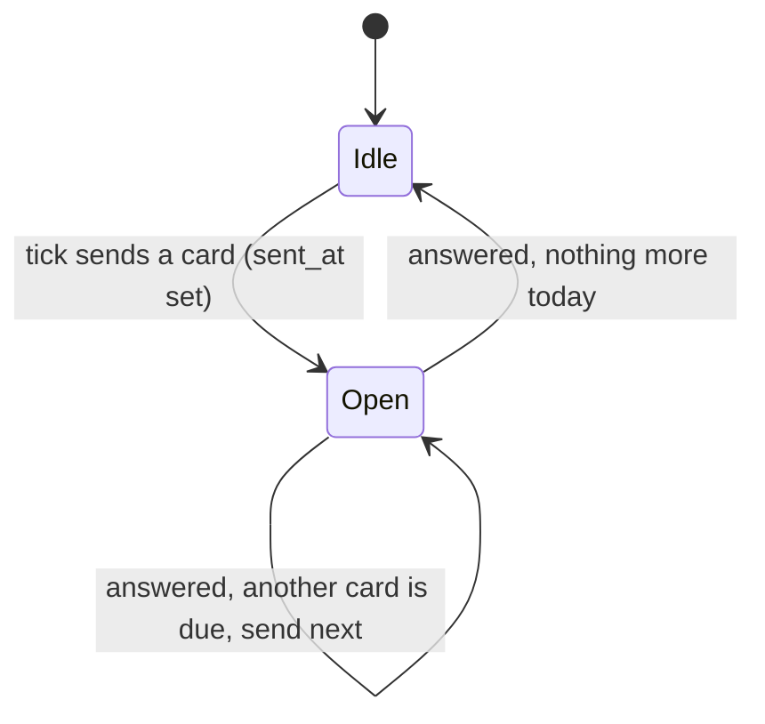
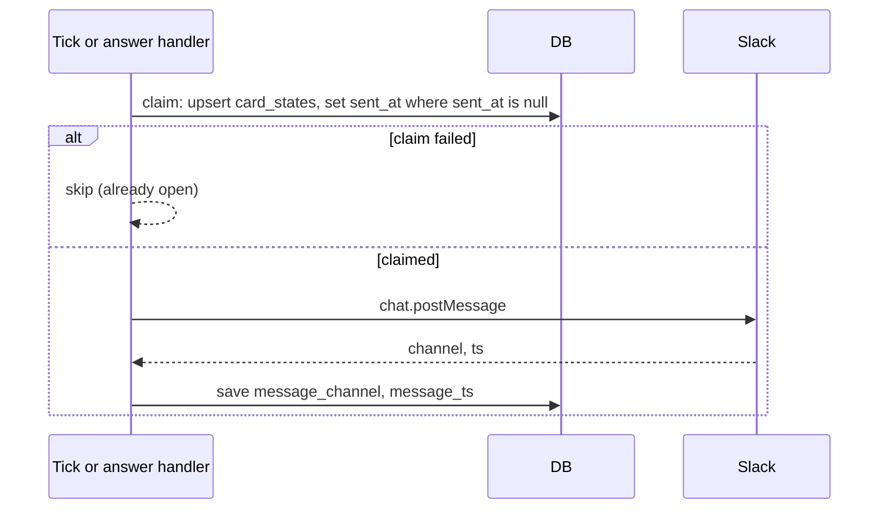

# Flashcard scheduler

Decides which card each student gets, when, and sends it. It lives in a service (`src/services/`), uses the pure rules in `src/domain/`, and sends through the Slack module. One process, no Redis.

## Delivery model ([decision 0008](decisions/0008-delivery-next-card-after-answer.md))

One open card per student per course. The next card is sent right after the previous one is answered, until the day's work is done. A daily tick starts the day by sending the first card.



A card left unanswered stays open and blocks the queue. It is not forgotten: see [Unanswered cards](#unanswered-cards). The student's streak and due date are untouched until they answer.

## Selecting the next card

```
next(enrollment, now):
  if course.status != 'active' or enrollment.status != 'active': none
  if enrollment.removed_at is not null: none                   // decision 0017
  if a card_states row has sent_at not null: none            // one open card
  if assessment_done_at is null:
      assessment cards without a row, by position            // assessment first
      (none left and all answered -> evaluateAssessment once)
  due   = card_states, learned_at null, due <= endOfLocalDay(now, tz), order by due
  new   = flashcards without a row, not assessment, by position,
          while introduced_today < quotaToday           // decision 0006
  return first of (due, then new)
```

- `endOfLocalDay` is the end of the student's local day (from `users.tz`, fallback `TENANT_TIMEZONE`). Comparing `due` with `now` would be wrong: the tick runs once a day at `SEND_HOUR`, so a card answered at 14:00 and due in 3 days has `due` of 14:00 on day 3, which is after the 09:00 tick, and would wait until day 4. Anything due today is sent at the morning tick.
- Learned (`learned_at` set) follows [decision 0015](decisions/0015-learned-needs-retention-gap.md): streak of 2 plus at least 7 days since the previous review. A card with a streak of 2 and a short gap is still due and is asked again.
- The answer service passes `dueNotAfter` to `applyAnswer`: the end of the local day (student timezone) before `courses.ends_at`. FSRS dues after that are clamped to it, so every unlearned card gets a last review before the course ends. See [fsrs-calculator.md](fsrs-calculator.md#clamping-due).
- Not decided: what to do with cards introduced late; see the open question below. Until it is decided, late cards may stay unlearned and progress shows that honestly.
- A card gets its `card_states` row when first sent (`newCardState(now)`), with `introduced_at = now` and `sent_at = now`.
- `introduced_today` counts `introduced_at` inside the student's local day.
- Zero assessment cards in the course: `next()` sets `assessment_done_at = now`, leaves `assessment_score` null, and continues in normal mode in the same call. This is the same completion step as after the last assessment answer, minus the evaluation.
- `quotaToday = ceil((remainingNew + introducedToday) / remainingDays)` ([decision 0006](decisions/0006-new-cards-per-day.md)), recalculated each day from the number of unintroduced non-assessment cards and the local days left through `ends_at`. Assessment cards are not counted.
- Assessment cards ignore the quota; the student gets them all, one after another, before anything else.
- Due cards have no daily cap in the MVP. If a student falls behind, the backlog drains one card per answer. Open: add `MAX_DUE_PER_DAY` if students complain.
- Completion ([decision 0011](decisions/0011-enrollment-completed.md)): an `active` enrollment becomes `completed` when all its cards are learned or when the course reaches `ends_at`, whichever comes first. The tick (and the answer handler after the last learned card) sets `status`, `completed_at` and `completed_progress`, and sends a DM (congratulation, or "the course has ended" with the final progress). A completed enrollment gets no cards and no reminders.
- At `ends_at` the tick completes every remaining `active` enrollment and sets the course to `finished`.
- Exempt students get no cards and never become `completed`.

> **Open question: short courses cannot finish.** The daily N spreads new cards over the whole course ([decision 0006](decisions/0006-new-cards-per-day.md)), and a card is learned only after a 7-day retention gap ([decision 0015](decisions/0015-learned-needs-retention-gap.md)). Together, a card introduced late has no time left to reach the gap before `ends_at`. In the walkthrough's 12-day course a student who answers every card Medium can learn only about 5 of 10 cards (the user's estimate, not recomputed here). Options:
>
> 1. Stop introducing new cards `INTRO_CUTOFF_DAYS` (10) before `ends_at`.
> 2. Scale `MIN_RETENTION_DAYS` with the course length.
> 3. Require courses of about 4 weeks or more (reject or warn at `start`).
>
> Decide before Task 6 (scheduler); the choice changes the selection rule and the quota formula.

## When a card is sent

- Course start and enrolling a student into an active course send the first assessment card at once (not gated by `SEND_HOUR`).
- After an answer, the answer handler calls `next()` immediately and sends the next card if there is one. Same selection rule, same daily new-card cap, no `SEND_HOUR` gate.
- The daily tick restarts students who have no open card and whose local hour is at least `SEND_HOUR`.

## Unanswered cards

A card counts as open while `card_states.sent_at` is set. Without a rule an ignored card would stay open forever and the student would never see another one.

The tick, for each open card with a stored `message_ts`, in a `active` enrollment of an `active` course, and when the student's local hour is at least `SEND_HOUR`:

1. Reminder due when `coalesce(reminded_at, sent_at) + REMINDER_AFTER_HOURS <= now` and `reminder_count < MAX_REMINDERS`.
2. Re-post the same card as a new message ("Reminder: you have an open card" plus the question and buttons) and replace the old message with "Sent again below" and no buttons.
3. Store the new `message_channel` and `message_ts`, set `reminded_at = now`, `reminder_count = reminder_count + 1`. `sent_at` does not change: it is still the same delivery, so an answer to either message closes it once.
4. After `MAX_REMINDERS` reminders nothing more is sent. The card stays open and the student can still answer the last message; the next card follows the answer.
5. **The open card blocks that student's course** (one open card at a time, [decision 0008](decisions/0008-delivery-next-card-after-answer.md)), however long it stays unanswered. The teacher sees it: the progress endpoints return `waiting_since`, the open card's `sent_at`, or null when no card is open ([rest-api.md](rest-api.md#progress-teacher)). The blockage ends when the student answers, the enrollment is removed, or the course ends. The system does not skip the card by itself.

A click on an older message than the stored `message_ts` is answered with "This card was sent again, use the latest message" and does not change state. Nothing is lost by ignoring a card: the streak and `due` stay as they were until the answer.

At `ends_at` or on stop, open cards are closed with the enrollment ([completion](#selecting-the-next-card)); a late click gets "the course is over".

## Removed students and cleanup

[Decision 0017](decisions/0017-enrollment-soft-delete.md). Every selection, reminder and completion query filters `enrollments.removed_at is null`.

- On removal the service voids the open card: replaces the Slack message with "expired", then clears `sent_at`, `message_ts`, `reminded_at`, `reminder_count`. Progress and `status` are untouched.
- A click on an expired card gets "You are no longer enrolled in this course" and changes nothing.
- Re-enrolling inside the window clears `removed_at`; the next `next()` call picks up overdue cards and re-sends the voided card.
- `ends_at` completion ignores removed enrollments.
- **Daily cleanup**, run by the tick once per day: for each enrollment with `removed_at < now - REMOVED_RETENTION_DAYS` delete, in one transaction, the student's `reviews` and `card_states` for the flashcards of that course, then the enrollment row. The `users` row stays.

## Tick

`setInterval` every 15 minutes in the API process.

Once per day (the first tick after local midnight of `TENANT_TIMEZONE`, tracked in memory and safe to repeat) the tick also runs the removed-students cleanup described above: hard-delete after `REMOVED_RETENTION_DAYS`.

On every tick, for each present (`removed_at is null`) active enrollment of an `active` course with no open card:

1. Compute the local date and hour from `users.tz` (fallback `TENANT_TIMEZONE`) using `Intl.DateTimeFormat`.
2. If local hour is at least `SEND_HOUR` (default 9) and no card was sent to this student today, run `next()` and send.

If every student shares a timezone, one daily tick is enough; the per-student version costs only the tz lookup.

## Idempotent send



- Crash after the claim and before Slack: a row has `sent_at` older than 10 minutes and no `message_ts`. The tick re-sends it. A rare duplicate DM is acceptable because answers are idempotent (`reviews` unique on `delivery_sent_at`).
- The claim is a single `UPDATE ... WHERE sent_at IS NULL` so two ticks cannot both win. With more than one instance, use `FOR UPDATE SKIP LOCKED`.

## Answer path

1. Handler `ack()`s, parses the button value, loads the card state and checks `sent_at` is set.
2. Wrong or "Don't know": `applyAnswer` now. Right: show Hard / Medium / Easy, no state change.
3. Rating click: `applyAnswer`, insert the review (unique key rejects repeats), update `card_states`, clear `sent_at`, replace the Slack message with the outcome.
4. If it was the last assessment card, `evaluateAssessment`.
5. Call `next()` and send the next card if any.

Steps 3 to 4 run in one transaction.

## Load

1,000 students at a few to a dozen cards per day is a few thousand DMs. Send sequentially; the Slack client retries on HTTP 429 using `Retry-After`. `chat.postMessage` is roughly 1 message per second per channel with bursts allowed, and each student's DM is its own channel. No rate limiter is built for the MVP. Do not use `Promise.all` over the whole class.

## Config

| name | default | where |
| --- | --- | --- |
| `SEND_HOUR` | 9 | env |
| `TENANT_TIMEZONE` | `UTC` | env |
| `TICK_MINUTES` | 15 | env |
| `REMINDER_AFTER_HOURS` | 24 | env |
| `MAX_REMINDERS` | 2 | env |
| `REMOVED_RETENTION_DAYS` | 14 | env |
